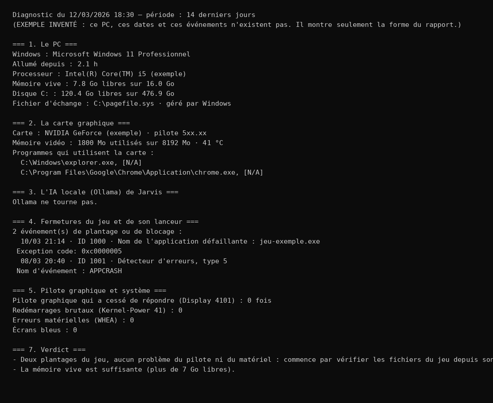

# Outils PC Windows

Des petits scripts PowerShell pour comprendre ce qui se passe sur un PC Windows : pourquoi un jeu se ferme, qui ouvre des fenêtres noires, où part la place sur le disque.

## Les scripts

| Script | À quoi il sert | Ce qu'il lit | Ce qu'il écrit |
|---|---|---|---|
| `DIAGNOSTIC-PC.bat` → `diagnostic-pc.ps1` | Chercher pourquoi un jeu (Valorant) se ferme : plantages, carte graphique, mémoire, anti-triche, IA locale qui occupe la carte. Finit par un verdict en phrases simples. | Journaux d'événements Windows (14 derniers jours), état de la carte graphique (`nvidia-smi`), services, programmes en cours | Un seul fichier : `diagnostic-AAAA-MM-JJ_HHMM.txt`, à côté du script |
| `QUI-OUVRE-CMD.bat` → `qui-ouvre-cmd.ps1` | Trouver quel programme ouvre des fenêtres CMD toutes seules : il note chaque nouveau programme lancé et qui l'a lancé. | La liste des programmes (toutes les 0,7 s) | `qui-ouvre-cmd-AAAA-MM-JJ_HHMM.txt` (les longs jetons sont masqués) |
| `analyser.ps1` | Faire l'inventaire du disque : gros fichiers, vieux fichiers, installeurs oubliés, doublons exacts, applications installées. | Les dossiers de l'utilisateur et des autres disques (sans OneDrive, Windows, Program Files ni dossiers de jeux) | `inventaire.js`, à côté du script |
| `PAUSE_OLLAMA.bat` | Avant de jouer : met en pause l'IA locale (Ollama) et mon assistant Jarvis, et surveille qu'ils ne se relancent pas. | La liste des programmes | `pause_ollama_journal.txt` |

**Garantie « lecture seule »** : `diagnostic-pc.ps1`, `qui-ouvre-cmd.ps1` et `analyser.ps1` ne suppriment, ne déplacent, n'installent et ne modifient rien ; ils écrivent seulement leur rapport à côté d'eux. `PAUSE_OLLAMA.bat` est le seul qui agit : il ferme Ollama et les programmes de Jarvis (liste fermée), jamais le jeu, Discord ou une autre application, et il ne supprime rien.

## Lancer

Double-clic sur le `.bat`. Ou dans PowerShell :

```
powershell -NoProfile -ExecutionPolicy Bypass -File .\diagnostic-pc.ps1
```

Pour `PAUSE_OLLAMA.bat`, la variable `JARVIS_DOSSIER` indique où se trouve `JARVIS.bat` (sinon : le dossier du fichier).

## Un rapport d'exemple

[`exemples/diagnostic-exemple.txt`](exemples/diagnostic-exemple.txt) : un rapport inventé, qui montre seulement la forme du résultat.



## L'ange gardien de la mémoire

Dans mon assistant Jarvis, un petit programme surveille la mémoire du PC, même quand Jarvis est éteint et que je joue : [`jarvis/outils/gardien_memoire.py`](https://github.com/jessim-noui/jarvis/blob/main/jarvis/outils/gardien_memoire.py).

- Il vérifie la mémoire **toutes les 5 secondes**, sans IA, sans Internet et sans lire aucune clé.
- **À 80 %**, il note quels programmes prennent la mémoire et vide la mémoire de l'IA locale (Ollama) si elle tourne.
- **À 90 % pendant 10 secondes**, il ferme l'IA locale, puis Jarvis (serveur, routeur, bot), prévient par une notification Windows et note l'avant/après.
- **Sa liste est fermée** : il ne ferme jamais rien d'autre, ni le jeu, ni Chrome, ni Discord. Il dit seulement qui prend la place.

---

Conçu et piloté par moi ; code écrit avec l'aide d'un assistant IA, relu, testé et compris.

Licence MIT — voir [LICENSE](LICENSE).
